<!-- prior-cognitive-art-render-input: 05eb9a0f1ea39e70879ac6d4d268a625cbd73e73b7e03b85d201af4a97d38a23 -->

# Abstract: A Conceptual Map of Prior Origins, Art, and Fixed-Point Explanation

A prior is not explained by stacking more priors; it is located by mechanism, function, history, and fixed-point organization. The paper's precise thesis is procedural: before asking why
a prior exists, identify which explanatory kind is being requested and name the
rule that will terminate the explanation. This working paper argues that Tinbergen's four questions
are not stacked levels in one causal chain. They are crossed axes: proximate
versus ultimate, and static versus developmental. Mechanism and function ask
what a prior is doing now; ontogeny and phylogeny ask how such organization came
to be across different timescales.

The paper treats the familiar "prior on a prior" problem in hierarchical Bayes
as structurally parallel to an ontogenetic account that says one prior selects
another. Both postpone the question unless they terminate. Three termination
families organize the paper: pragmatic closure, selection closure, and
fixed-point termination. They are organizing families, not an exhaustive
taxonomy of every possible explanation. A final upstream pass asks what comes
before the first prior and answers with a constraint stack -- viability,
allostasis, co-homeostasis, development, and niche support -- rather than with a
hidden meta-prior. The project uses plain text, deterministic conceptual visualizations, and one deterministic illustrative simulation trace.
Its supplement adds generated, auto-numbered formal claims and a closed symbol
glossary as text-integrity artifacts rather than empirical machinery.
The paper includes one deterministic illustrative simulation trace over authored formal states; it does not run stochastic simulations, synthetic-data experiments, empirical estimates, or performance benchmarks.

The "art" in the title names the craft at stake: arranging explanatory kinds
(proximate/ultimate, static/developmental, selection/fixed-point) so that no
single kind is mistaken for the whole, and rendering that arrangement as
deterministic figures and checkable formalism rather than as empirical simulation evidence. It
also marks a bounded link to aesthetic practice: artworks can stage encounters
with expectations, material affordances, ambiguity, and meaning, but this paper
treats that link as a conceptual analogy, not as an empirical theory of art.


---


# Introduction: Why the Question of a Prior's Origin Needs More Than Ontogeny {#sec:introduction}

The question "why is there a prior?" is ill-typed until the explanatory kind is
identified. It becomes unstable when the answer is only
"because an earlier process selected it." That move is not wrong, but it is
developmental, and developmental answers naturally invite another question about
where the selecting process came from. This is the same shape as the hyperprior
problem in hierarchical Bayes: a prior receives another prior above it, which
receives another, until the account stops by convention or by a stronger
explanatory rule. The paper therefore treats "why" as a typed request, not as a
license to stack levels indefinitely [@jaynes2003probability; @pearl2009causality;
@gelman2013philosophy].

Tinbergen's four questions help locate the issue [@tinbergen1963aims;
@mayr1961cause; @bateson2004toward; @bergman2022leveling]. The questions are often read as a
ladder, but for this manuscript they are a grid. One axis asks whether the
account is proximate or ultimate. The other asks whether the account is static
or developmental.
Mechanism is proximate-static; function is ultimate-static; ontogeny is
proximate-developmental; phylogeny is ultimate-developmental. The four questions
are not four rungs of a single explanatory climb; they are four cells of a
two-by-two map, and the regress pressure arises when one cell is asked to carry
the load of all four.

This grid is an explicit analytic re-description, not a claim that Tinbergen's
framework is uniquely or naturally a Cartesian product. Bergman and Beehner's
causes/consequences leveling is compatible as a reorganization, but it does not
license treating the two-axis map as an empirical taxonomy [@bergman2022leveling].

An ontogenetic answer keeps an important part of the story: it explains how a
prior was acquired or tuned in an individual history. It cannot carry the entire
explanatory load. By itself, it does not explain why that developmental channel
was available, why that class of priors persisted, or why the system is
organized so that "having a prior" is the right description
[@friston2015active; @friston2015free]. In Bayesian practice, the analogous
problem appears when a prior is justified by a hyperprior, and the hyperprior
by another hyperprior. The iteration is technically harmless — it just produces
a deeper model — but it is explanatorily inert unless a termination condition
is named that is not itself another prior [@gelman2013philosophy; @bernardo1979reference].

The free energy principle provides the most developed contemporary site for
this problem. A system that minimizes variational free energy under a Markov
blanket can be described as instantiating a generative model. Here, *prior*
means a distribution or parameterization supplied before the current update;
*posterior* means the distribution after conditioning; and *prior-like*
means a broader organizational constraint that may support inference without
being a Bayesian prior in that narrow sense. Sufficient statistics of a model
are therefore not automatically priors: the manuscript uses them only when
their role is explicitly identified as a prior or prior-like constraint
[@friston2010free; @friston2013life; @hohwy2016self]. But the Markov blanket
must be used with care. In active-inference work it is a statistical boundary
within a model of the system; in stronger biological readings it is connected
to autonomy and self-individuation [@kirchhoff2018markov]. Recent critiques
warn that those two registers should not be conflated: a Markov blanket can
organize an explanatory model without automatically demarcating the literal
physical or cognitive boundary of an organism [@bruineberg2022emperor;
@raja2021markov]. The more recent mathematical expositions of active inference
and the free energy principle reinforce the same discipline: action,
perception, and model evidence belong to a formal description whose scope has
to be stated [@friston2012agency; @friston2023simpler]. This creates the same
question at a deeper level: if the prior-like structure is a bounded model of
what the system maintains, then "where did the prior come from?" is not
answered by naming another prior above it. The answer must either be pragmatic
(stop here for calculation), selective (filter by viability), or fixed-point
(the system is the prior-like settlement, not a bearer of one more hidden
prior). These are the paper's three organizing families, not a claim that the
space of explanatory stops is exhausted by them.

The harder upstream version asks what comes before the first prior, or what
could count as a bias before explicit bias. The manuscript treats that question
as a first-principles pressure test. If "prior" means an inferential parameter,
then putting another prior before it merely restarts the regress. The better
answer is pre-inferential constraint: viability asymmetries, predictive bodily
regulation, shared early-life regulation, and developmental niche structure
make some expectation-forming paths available before they become belief-like
priors. Work on the body as first prior, co-embodiment and co-homeostasis,
allostatic regulation, visceral rhythmicity in development, morphogenesis, and
evolved active-inference architectures supports this upstream frame
[@allen2018body_first_prior; @ciaunica2021first_prior;
@sterling2012allostasis; @corcoran2025body_first_teacher;
@kuchling2020morphogenesis; @pezzulo2022evolution]. This is not a discovery of
a literal hidden meta-prior. It is a category correction: before learned priors
come histories of regulation, support, embodiment, and viable form.

The working hypothesis is therefore modular: the regress is not a property of
Tinbergen's framework; it is a property of choosing the ontogenetic quadrant as
the whole answer. Once the quadrants are kept distinct, the regress can be
located in a specific move — treating a developmental answer as a complete
one — rather than in the explanatory apparatus itself. The methodological
consequences are developed in [@sec:method], the visual atlas in
[@sec:visual-atlas], and the formal claims in [@sec:formal-supplement]. The
conclusion synthesizes these threads in [@sec:conclusion].

- **Tinbergen is crossed, not stacked**: Mechanism, function, ontogeny, and phylogeny form two axes: proximate versus ultimate and static versus developmental.
- **Ontogeny alone keeps deferring**: Treating development as the whole answer to why a prior exists moves the question to the developmental source of that prior.
- **Biological inheritance mirrors hyperprior inheritance**: Prior-selects-prior in developmental language has the same shape as prior-on-prior in hierarchical Bayes.
- **Three termination families organize the paper**: The paper organizes the regress around pragmatic, selection, and fixed-point termination families without claiming that these exhaust every possible explanatory stop.
- **Before the first prior is constraint history**: Going upstream does not reveal a hidden prior before all priors; it reveals viability, regulation, shared embodiment, developmental tuning, and niche structure that make learned priors possible.
- **Joint structure precedes factor cleanup**: The argument is adjacent to lambda-decomposition work because joint organization can be prior to the factors later extracted from it.
- **Priors are co-shaped by system and niche**: The prior-like structure is not fully given by the environment nor fully endogenous; it is co-shaped by the organism and its niche.
- **Markov blankets are achieved, not given**: The statistical boundary separating internal from external states is part of what the persisting system achieves, not a boundary imposed from outside.
- **Tinbergen questions are complementary, not rival**: The four questions are complementary perspectives on the same phenomenon; conflating them is the source of the regress, not the framework itself.
- **Active inference closes the action-perception loop**: Active inference couples perception and action while distinguishing variational free energy for inference from expected free energy for policy selection, closing the explanatory loop the prior was meant to serve.
- **Prior-like structure recurs across scales**: The regress-termination problem recurs at the cellular, organismic, and social scales; the fixed-point move applies at each level without requiring a new hidden prior.
- **Art arranges encounters with priors**: The paper's art claim is bounded: aesthetic practices arrange cues, contexts, and meanings that interact with predictive priors; they do not prove that art directly rewires priors as an empirical mechanism.

The supplement formalizes this hypothesis only where the notation improves
accountability. Its claims are auto-numbered from source records, its symbol
glossary is generated, and its integrity token is injected into the rendered
text. The formalism is a validation aid, not a simulation model. The paper
sits alongside policy-entanglement and lambda-decomposition work in which
joint organization may be prior to the factors later extracted from it
[@da_costa2020active; @parr2022active]. The "art" in the title is meant in this
sense: the craft of keeping explanatory kinds distinct and rendering that
distinction as deterministic figures and checkable claims, rather than as a
metaphysical theory of priors.

This use of "art" is also disciplined by recent predictive-processing
aesthetics. Work on visual art, music, and neuroaesthetics shows that aesthetic
experience often turns on learned expectations, uncertainty, affect, and
meaning-making [@van_de_cruys2011putting; @pearce2018statistical;
@frascaroli2024aesthetics; @pearce2016neuroaesthetics]. That literature
supports the paper's modest analogy: aesthetic practices arrange encounters
with priors and prediction errors. Material-engagement and extended-mind work
make the analogy more public and embodied: art-making uses artifacts, media,
and situated practice to make expectations available for inspection rather
than keeping them inside the head [@dewey1934art; @clark1998extended;
@varela1991embodied; @thompson2007mind;
@malafouris2013things; @noe2015strange; @wynn2021four_e]. None of this
supports a stronger conclusion that art is reducible to prediction-error
optimization, that aesthetic value is the same as epistemic value, or that the
free energy principle is a complete theory of art [@kesner2014predictive;
@burnett2020four_e; @brown2009arts; @bowers2012bayesian].


---


# Conceptual Method: Typed Explanations and Source-Owned Artifacts {#sec:method}

This is a conceptual paper. It includes one deterministic illustrative
simulation trace over authored formal states, but it uses no stochastic
simulation, no synthetic data, no empirical-effect estimate, and no numerical
performance claim. Its method is diagrammatic clarification: keep the
quadrants, regress types, trace states, and termination moves explicit enough
that the prose cannot silently trade one explanatory kind for another. The
methodological commitment is that the distinction between explanatory kinds —
proximate versus ultimate, static versus developmental — must be preserved
through every stage of the argument. When the distinction is lost, the regress
reappears as if it were forced by the framework, when in fact it is forced by a
category error: asking a developmental question to answer a static one.

The source layer records 4 Tinbergen quadrants,
3 termination modes, 12 argument
modules, 21 figure specifications, 12 formal
claims, and 35 glossary rows. Those records are rendered into
visual artifacts, supplement formalisms, and manuscript variables during the
analysis stage. The visual inventory is deliberately partitioned: the atlas
contains 18 argument diagrams, while the formal
supplement contains 3 contract diagrams.

## Operational Protocol

The manuscript applies a compact five-step protocol to each "why" question:

1. **Type the request.** State whether the question concerns mechanism,
   function, ontogeny, phylogeny, or another explicitly named explanatory kind.
2. **Expose deferral.** Show whether the proposed answer merely moves the
   prior to a hyperprior, selector, or earlier developmental condition.
3. **Name the stop.** Identify pragmatic, selection, or fixed-point closure when
   one of those families does the relevant explanatory work; do not imply the
   list is exhaustive.
4. **State the ceiling.** Mark what the stop explains and what it leaves open,
   especially for Markov blankets, niche construction, and aesthetic analogy.
5. **Render and validate.** Generate the diagram and formal record from the
   source inventory, hydrate the prose, and reject stale or mismatched outputs.

This protocol is an accountability device, not a causal model or an empirical
estimator. It makes category changes visible before they become prose claims.

## Tinbergen Crossed With Prior Explanation

[@tbl:tinbergen_quadrants] lays out the crossed structure. Mechanism and
function are static: they can close locally by saying what a prior is doing now.
Ontogeny and phylogeny are developmental: they explain how a structure came to
be over time. The regress appears when a developmental answer is asked to serve
as the whole explanation.

| Question | Scale | Time-form | Prior question answered | Regress status |
|---|---|---|---|---|
| Mechanism | proximate | static | What the prior is doing now inside the system. | closes locally by naming present causal organization |
| Function | ultimate | static | What the prior is for now in selection-structured terms. | closes locally by naming viability and use |
| Ontogeny | proximate | developmental | How the prior became shaped across an individual history. | defers the question to the source of that history |
| Phylogeny | ultimate | developmental | How the prior persisted across population histories. | blocks regress through selection-filtered survival |

: Tinbergen quadrant map for prior explanation. {#tbl:tinbergen_quadrants}

The table makes the main constraint visible. Mechanism and function are static
in the relevant sense: they can close locally by saying what a prior is doing
now. Ontogeny and phylogeny are developmental: they explain how a structure came
to be over time. The regress appears when a developmental answer is asked to
serve as the whole explanation. This is why Bateson and Laland's update of
Tinbergen's framework matters: they show that the four questions are
complementary, not competing, and that conflation among them is the source of
persistent confusion in ethology and beyond [@bateson2004toward]. Bergman and
Beehner's cause/consequence leveling is useful because it shows the framework
can be reorganized without losing the need for explanatory distinctions
[@bergman2022leveling]. The same conflation arises when "why is there a prior?"
is answered by only naming a developmental channel. Konner's nine-level
proposal is useful here as a cautionary extension rather than as a replacement:
one can split Tinbergen's questions into finer levels, but this paper depends
only on preserving the kinds of explanation they name [@konner2021nine]. The category-theoretic
distinction between explanatory kinds is not merely terminological: it tracks a
real difference in what an explanation is being asked to do [@smith2000formal;
@godfrey2013theoretical].

## Regress-Closure Strategies

- **Pragmatic termination** (formal sufficiency): Install a flat or weak hyperprior and stop asking. Limitation: It is useful for calculation but thin as an explanation.
- **Selection termination** (viability filtering): Function and phylogeny answer why this prior persists. Limitation: It explains persistence, not the fine structure of a single organism.
- **Self-referential termination** (fixed-point individuation): The prior is the settled organization of the process it constrains. Limitation: It must be stated as a category shift, not another hidden prior.

These are closure strategies rather than three proofs that one metaphysical
question has been answered. The first move, pragmatic termination, is the standard move in applied
Bayesian statistics: install a weakly informative, reference, or penalized
complexity prior and then test whether the model is adequate for the task
[@gelman2013philosophy; @simpson2017penalising]. It is epistemically honest
about its own limitation: prior predictive checks, posterior predictive checks,
and sensitivity analysis regularize inference without claiming to discover the
origin of the prior. The second move, selection termination, treats the prior as
the surviving form after viability filtering by function and phylogeny
[@friston2015free; @constant2018free]. It explains persistence without
explaining fine structure.
The third move, fixed-point termination, is the most interesting for cognitive
science because it changes the grammar of the question. Instead of asking for a
prior behind the prior, it asks whether the persisting organization of the
system is what the term "prior" was naming.

That is why the free energy principle and Markov blanket self-individuation
matter here [@friston2010free; @ramstead2018answering; @kirchhoff2018markov].
When the Markov blanket is treated as a model-level boundary tied to the
system's self-maintaining dynamics, the prior-like structure becomes a bounded
description of organization rather than a parameter received from a higher
level [@constant2018free; @hohwy2016self]. The critique literature matters
because it blocks an overclaim: the notation does not by itself identify a
literal organism boundary, so the fixed-point move must be stated as a bounded
modeling claim, not a metaphysical shortcut [@bruineberg2022emperor;
@raja2021markov]. The system does not have a prior in the way it has a property;
it persists as the organization that makes prior-like constraint legible.

## Before The First Prior

The first-principles version of the problem asks what is upstream of the first
inferential prior. This paper answers by refusing to treat "before" as another
level in a Bayesian hierarchy. A prior-before-priors would only duplicate the
hyperprior regress. The upstream layer has to be a different explanatory kind:
viability constraints, regulatory asymmetries, embodied support, and
developmental scaffolding that make expectation-forming possible before the
organism can own an explicit prior.

This move draws on four adjacent literatures. Interoceptive predictive
processing treats the body as a first prior for self-modeling, which shifts the
origin question from detached belief to regulatory bodily organization
[@allen2018body_first_prior]. Early-life co-embodiment and co-homeostasis work
pushes farther upstream: bodily regulation is initially shared with caregivers
and environments rather than privately possessed [@ciaunica2021first_prior].
Allostasis names predictive regulation as a core physiological pattern, while
recent developmental work on rhythmic visceral dynamics describes how bodily
regularities can teach early cognition before explicit conceptual learning
[@sterling2012allostasis; @corcoran2025body_first_teacher]. Finally,
morphogenesis and evolutionary active-inference accounts suggest that
constraint histories can be biological and architectural before they are
cognitive in the narrow sense [@kuchling2020morphogenesis;
@pezzulo2022evolution; @linson2018active_ecological].

The RedTeam boundary is therefore strict. These sources license an upstream
constraint stack, not a literal first-prior discovery. "Bias before bias" means
asymmetry before inference: some forms are viable, regulatable, shareable, and
developmentally reachable before they are available as priors in a model.
[@fig:first_prior_grounding_stack] renders that distinction as a visual
constraint stack.

## The Role of Niche Construction

The niche-construction reading of the free energy principle deepens the
selection-termination move. Foundational niche-construction theory argues that
organisms modify the selection pressures they and their descendants face, and
that cultural practices can participate in that feedback
[@laland2000niche; @odling_smee2003niche]. Constant and colleagues add the
variational version: organisms actively structure their niche, and the niche
structures them back, so that the statistical regularities exploited by the
organism are partly of its own making [@constant2018free;
@baltieri2022extended]. Developmental niche construction adds an important
boundary: the constructed environment does not only select among ready-made
forms; it also helps produce developmental variation and transmit resources
across generations [@stotz2017developmental]. This does not eliminate
selection — viability still filters what can persist — but it shows that the
filter is not purely external. The prior-like structure is co-shaped by the
system and its environment. This complicates the selection-termination move
without changing its logical role: it still blocks regress by naming what
persists rather than by adding another hidden level. The visual atlas in
[@sec:visual-atlas] renders this co-shaping diagrammatically.

## Active Inference and Variational Closure

Active inference extends the free energy principle to action and policy
selection [@friston2012agency; @friston2015active; @da_costa2020active;
@friston2017active].
Extended active-inference work makes the same point at the organism-niche
surface: action changes the sensory and material field in which future
inference occurs [@baltieri2022extended]. The prior serves a coupled
perception-action process, but the objectives must not be collapsed:
variational free energy evaluates an approximate posterior, whereas expected
free energy evaluates policies. This closes the explanatory loop without
claiming that inference and policy selection are the same optimization problem.
The variational free energy bounds negative log evidence from above, or
equivalently tightens the evidence lower bound as the approximate posterior
approaches the target posterior within its variational family
[@blei2017variational]. In this paper that formal fact is used narrowly: it
supports a model-internal settling interpretation of prior-like constraint, not
a claim that free energy literally vanishes or that variational inference has
derived the historical origin of the prior [@friston2019free;
@friston2023simpler; @da_costa2023bayesian; @bowers2012bayesian].

The same boundary applies to epistemic value. Active inference can model
information-seeking policies and uncertainty reduction [@friston2015active;
@parr2022active], but epistemic value is not aesthetic value. When the paper
uses aesthetic scholarship, it treats art as a field of staged expectation,
ambiguity, affect, and meaning, not as a proof that aesthetic worth is just
expected free-energy minimization [@van_de_cruys2024order;
@frascaroli2024aesthetics; @burnett2020four_e].

## Aesthetic Prior-Craft As A Bounded Analogy

Predictive-processing aesthetics offers the paper its title discipline. Visual
art, music, and aesthetic experience often involve learned regularities,
expectation, prediction error, affect, and meaning-making
[@van_de_cruys2011putting; @kesner2014predictive; @pearce2018statistical;
@starr2023aesthetic]. Those sources make it legitimate to say that artworks can
arrange encounters with priors: a painting, musical style, performance, or
conceptual work can build expectations, violate or loosen them, and invite a
viewer or listener to recover structure at another level. Neuroaesthetics adds
a useful triad of sensory-motor, emotion-valuation, and meaning-knowledge
systems, which keeps the account from reducing art to low-level perceptual
surprise [@chatterjee2014neuroaesthetics; @pearce2016neuroaesthetics].

The analogy becomes stronger, and safer, when art is treated as material
practice rather than as perception alone. Dewey's art-as-experience frame,
Noe's "strange tools" account, extended-mind theory, and material-engagement
archaeology all support a view in which artworks and art-making are public,
embodied, and artifact-mediated ways of reorganizing attention and action
[@dewey1934art; @noe2015strange; @clark1998extended;
@malafouris2013things; @malafouris2019mind; @wynn2021four_e]. Recent material-engagement work on
art and chance sharpens this point: making is not merely the execution of an
inner plan but an encounter with affordances, accidents, and media that can
change what counts as the next relevant move [@march2023art;
@malafouris2023enactychism]. In the paper's terms, the artwork is not a hidden
predictive model; it is a crafted environment in which prior-like expectations
are exposed, perturbed, and made legible. [@fig:aesthetic_prior_craft_map]
summarizes this source-to-claim boundary.

That analogy is deliberately bounded. Predictive processing is a fruitful lens
for expectation and ambiguity in aesthetic experience, not a master theory of
art. Enactive and 4E accounts emphasize that artworks are embodied,
sociomaterial practices and affordance fields, while neuroaesthetic critics warn
that the arts exceed narrow aesthetic preference or neural reward
[@rietveld2014rich; @burnett2020four_e; @brown2009arts]. Predictive accounts
of imagination and enactive accounts of surprise add the same caution from
another angle: prediction can illuminate imaginative perception and
improvisation, but it should not erase the difference between controlled
imagining, embodied discovery, and aesthetic practice [@jones2020prediction;
@cavedon_taylor2022predictive; @gallagher2022surprise]. The manuscript
therefore treats "prior cognitive art" as the craft of arranging explanatory
encounters with priors, not as a mechanism claim about artists' intentions,
viewers' neural updating, or imagination as prediction alone.

## Scale Recurrence

The regress-termination problem recurs at multiple scales. The fixed-point move
applies at each scale without requiring a new hidden prior: the prior-like
settlement at one scale becomes the substrate for the next. This recurrence is
a structural analogy, not a claim of scale invariance or empirical
self-similarity. Three concrete instances make the recurrence precise.

At the **cellular** level, the Markov blanket of a single cell is a prior-like
model of molecular organization: the cell maintains exchange statistics that
can be represented as a boundary process rather than received from a higher
level [@friston2013life; @kirchhoff2018markov; @bruineberg2022emperor]. At the
**organismic** level, the nervous system maintains prior-like constraints that
guide perception and action; the brain-body system is modeled as maintaining
its own action-perception boundary rather than being handed one from outside
[@friston2010free; @hohwy2016self; @maturana1980autopoiesis]. At the
**social** level, cultural practices and shared models function as prior-like
structures that organize collective behavior, and those practices are themselves
steady states of a population rather than externally supplied rules
[@constant2018free; @ramstead2023encultured]. In each case the same move
terminates the regress: identify the persisting organization rather than posit a selector behind it. The
fixed-point structure $X^*_k = \Phi(X^*_k)$ recurs, and the scale recursion
operator $R$ carries the settlement from one level to the substrate of the next
without introducing a new explanatory kind.

## Formal Supplement Protocol

The supplement uses generated numbering rather than hand-maintained labels. Each
formal claim is derived from source records, and every project-specific symbol in
those claims must appear in the generated glossary table. This gives the text a
lightweight integrity surface: if the formal notation and glossary drift apart,
the source contract fails before render. The contract is deliberately small — 12 claims, one glossary of
35 rows, 11 validation checks — because the point is not to
build a formal model but to make drift detectable.


---


# Visual Atlas: Eighteen Deterministic Argument Diagrams {#sec:visual-atlas}

This section is called a visual atlas rather than results because the paper does
not run experiments. It contains 18 conceptual
argument diagrams generated from the static source inventory. The complete
21-figure set also includes 3 contract diagrams
in [@sec:formal-supplement]; those supplement figures validate claims, symbols,
and text rather than add new substantive arguments. The one deterministic
simulation trace is an authored formal-state sequence, not stochastic sampling
or empirical evidence. Every figure is source-owned, captioned, and given
generated accessibility text.

## Tinbergen Axes

[@fig:tinbergen_axes] shows the central correction. Tinbergen's four questions
form two axes, not a stacked series of causes. The quadrant that creates regress
pressure is ontogeny when it is made to answer more than it can answer. Recent
work that re-levels Tinbergen into causes and consequences sharpens the same
point: the questions can be reorganized, but they cannot be collapsed into one
explanatory kind [@bergman2022leveling].

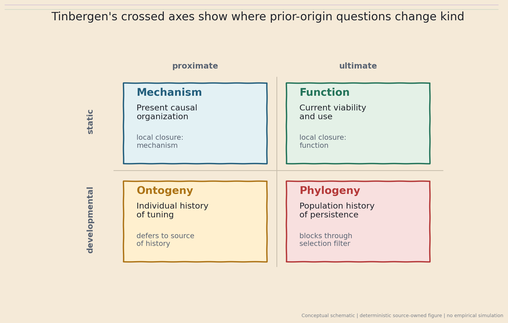{#fig:tinbergen_axes}

## Hyperprior Regress And Termination

[@fig:regress_terminations] maps the formal parallel between hierarchical Bayes
and developmental inheritance. A prior on a prior can always be extended upward.
A developmental prior that selects another developmental prior can always be
extended backward. The explanatory task is not to add another level; it is to
name the stopping condition. The pragmatic branch is continuous with Bayesian
workflow discipline: a prior is justified by model adequacy and regularization,
not by discovering an ultimate meta-prior [@gelman2013philosophy;
@simpson2017penalising].

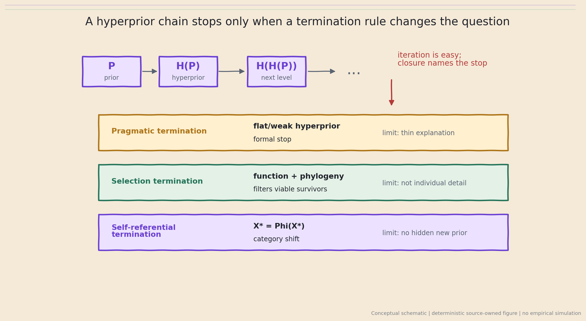{#fig:regress_terminations}

## Prior As Settled Equilibrium

[@fig:prior_equilibrium_map] sketches the fixed-point move. In this framing, a
prior is not an object inside the system that needs another prior above it. It
is the settled organization of perception, action, and boundary maintenance that
persists. This is where the argument sits closest to free-energy and
autopoietic readings of cognition [@friston2010free; @maturana1980autopoiesis].

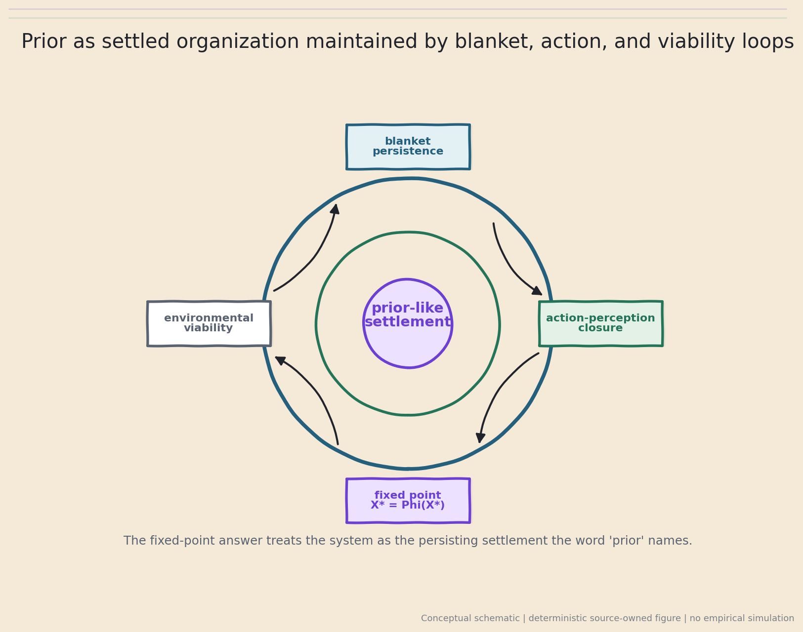{#fig:prior_equilibrium_map}

## Ontogeny And Hyperprior Shape

[@fig:ontogeny_hyperprior_parallel] makes the structural analogy explicit. In
hierarchical Bayes, a prior can be justified by a hyperprior, which can be
justified by another hyperprior. In an ontogenetic-only biological account, a
current prior can be justified by a developmental selector, which can then be
asked to justify its own source. The point is not that these are the same
substantive theory. The point is that they share a regress shape.

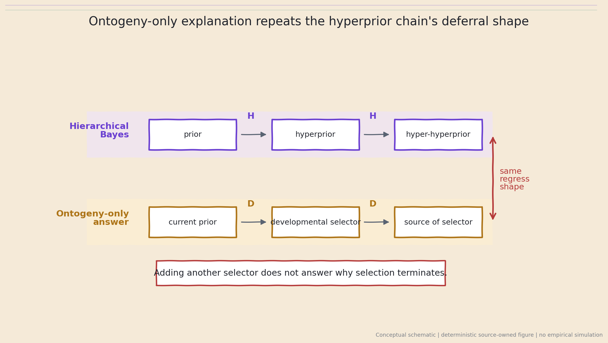{#fig:ontogeny_hyperprior_parallel}

## Selection Filter

[@fig:selection_filter] distinguishes selection closure from merely adding
another historical layer. Function and phylogeny do not answer every sense of
"why" the prior exists; they explain persistence by filtering the space of
candidate forms. Fragile, overfit, or miscalibrated priors do not remain
available as the objects whose origin we ask about. The figure therefore
represents a selection-based closure of the availability question, not a
complete causal history of the individual prior.

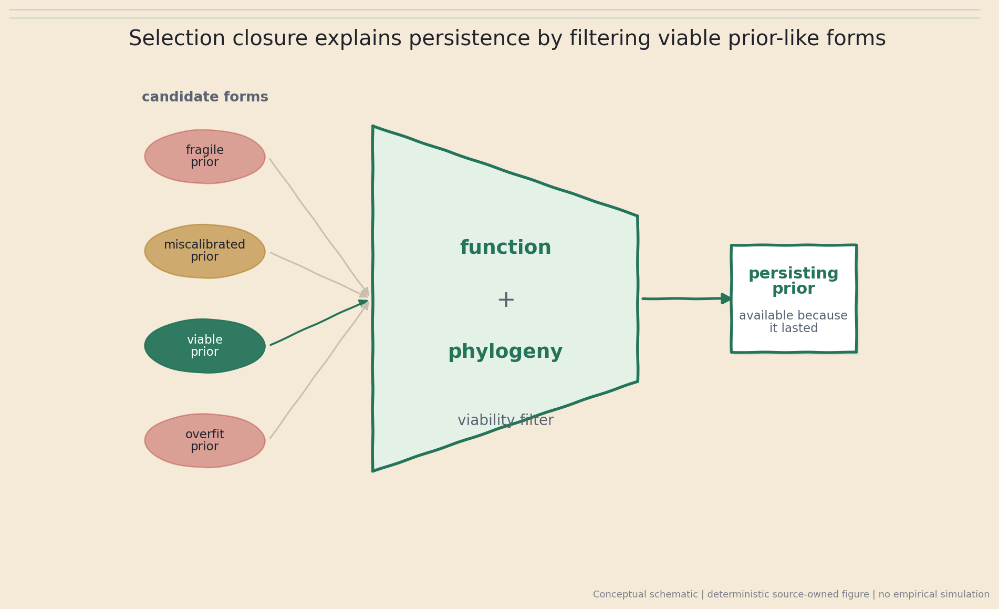{#fig:selection_filter}

## Policy Entanglement Bridge

[@fig:policy_entanglement_bridge] sketches why the argument sits beside
policy-entanglement work. If lambda-decomposition extracts policy, state, and
prior-like factors from an already joint structure, then those factors are useful
cuts rather than proof that the factors were ontologically first. This is the
same explanatory posture as fixed-point termination: organization can precede
the decomposition that later makes it legible.

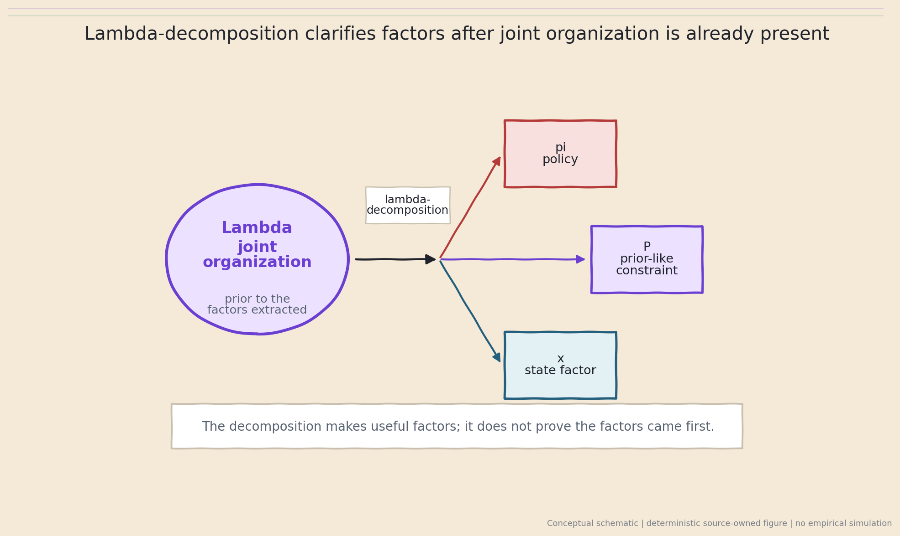{#fig:policy_entanglement_bridge}

## Niche Co-Construction

[@fig:niche_construction_diagram] shows how the prior-like structure is
co-shaped by organism and environment. The niche-construction reading does not
eliminate selection — viability still filters what can persist — but it shows
that the filter is not purely external. The prior is not fully given by the
environment nor fully endogenous; it is co-shaped by the reciprocal interaction
[@odling_smee2003niche; @laland2000niche; @constant2018free].

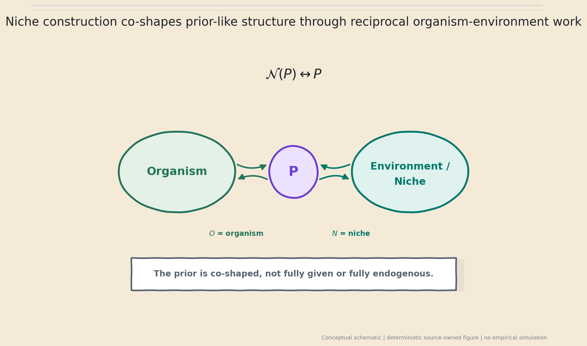{#fig:niche_construction_diagram}

## Markov Blanket As Achievement

[@fig:markov_blanket_achievement] shows the Markov blanket as a
self-maintaining model boundary rather than an externally imposed partition.
When the blanket is treated as an achievement of the system, the prior-like
structure becomes part of what the model describes the system as maintaining,
not a parameter received from a higher level [@kirchhoff2018markov;
@friston2013life]. The figure also marks the scope boundary introduced by
recent critiques: the notation is not enough by itself to settle organismal or
cognitive ontology [@bruineberg2022emperor; @raja2021markov].

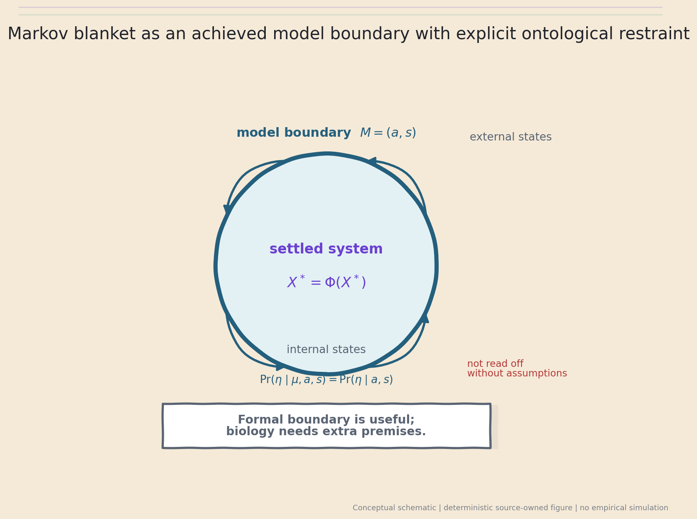{#fig:markov_blanket_achievement}

## Explanatory Complementarity

[@fig:explanatory_complementarity_matrix] shows the four Tinbergen questions as
complementary perspectives rather than rival hypotheses. The regress appears
when one question is asked to carry the load of all four; the framework itself
does not force it [@bateson2004toward; @bergman2022leveling].

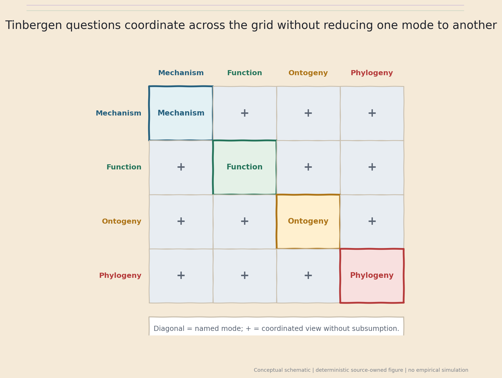{#fig:explanatory_complementarity_matrix}

## Active Inference Cycle

[@fig:active_inference_cycle] shows how active inference closes the
action-perception loop. The prior serves a coupled process in which variational
free energy evaluates approximate inference and expected free energy evaluates
policy selection; the two objectives should not be conflated
[@friston2012agency; @friston2015active; @da_costa2020active]. This closes the explanatory loop:
the prior is not merely a parameter for belief updating but a constraint on the
coupled perception-action system.

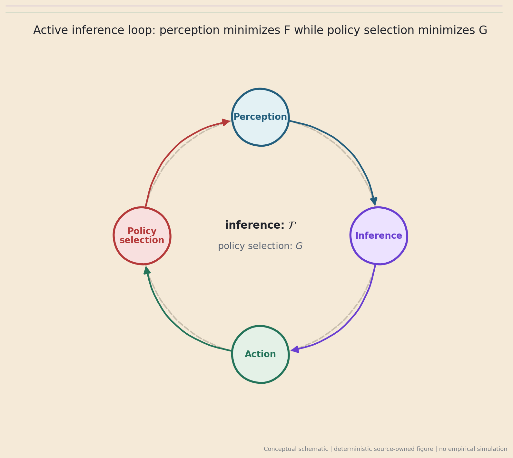{#fig:active_inference_cycle}

## Variational Free Energy Landscape

[@fig:variational_free_energy_landscape] shows the free-energy landscape as a
relative variational-bound landscape. The prior-like structure is not presented
as the literal floor of a vanishing free-energy surface. Instead, the figure
marks a model-internal settling interpretation: under the bound, approximate
posterior structure can approach a target posterior without turning the prior's
origin into an empirical result [@friston2010free; @friston2013life;
@blei2017variational; @friston2023simpler].

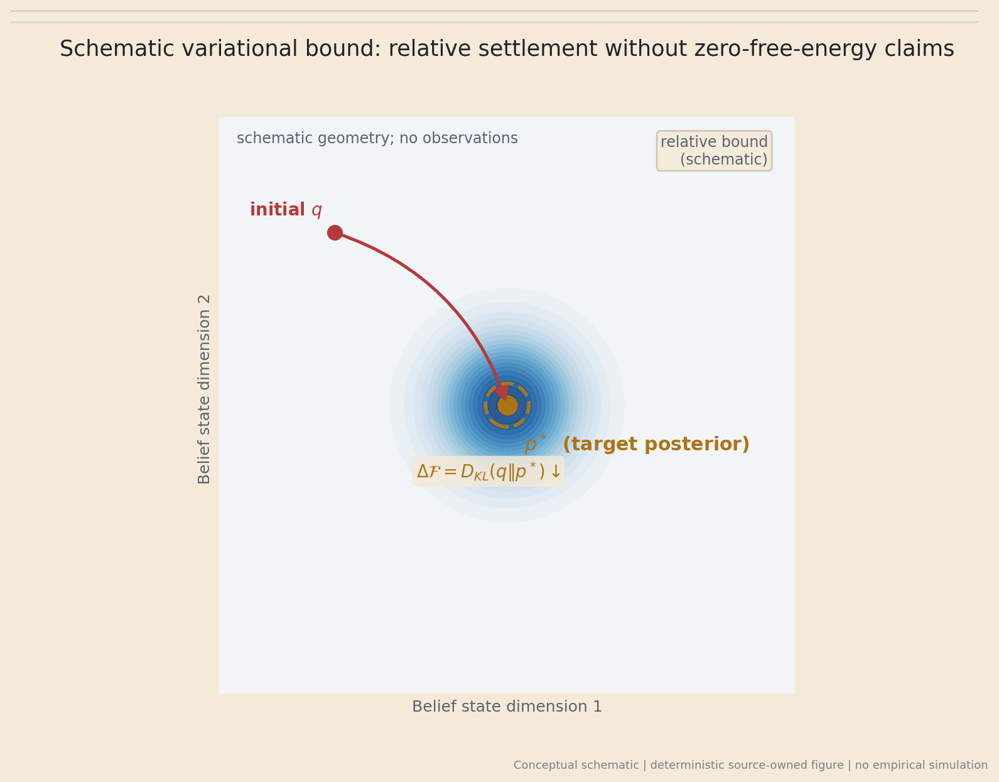{#fig:variational_free_energy_landscape}

## Deterministic Simulation Trace

[@fig:deterministic_simulation_trace] is the manuscript's only simulation-named
artifact, and its scope is intentionally narrow. It shows deterministic
simulation as an ordered trace over formal state labels: a question about the
prior, exposure of regress, Tinbergen partition, termination choice, and
fixed-point settlement. The figure does not model cognition, sample outcomes,
estimate effects, or report performance; it makes the formal state transition
surface inspectable.

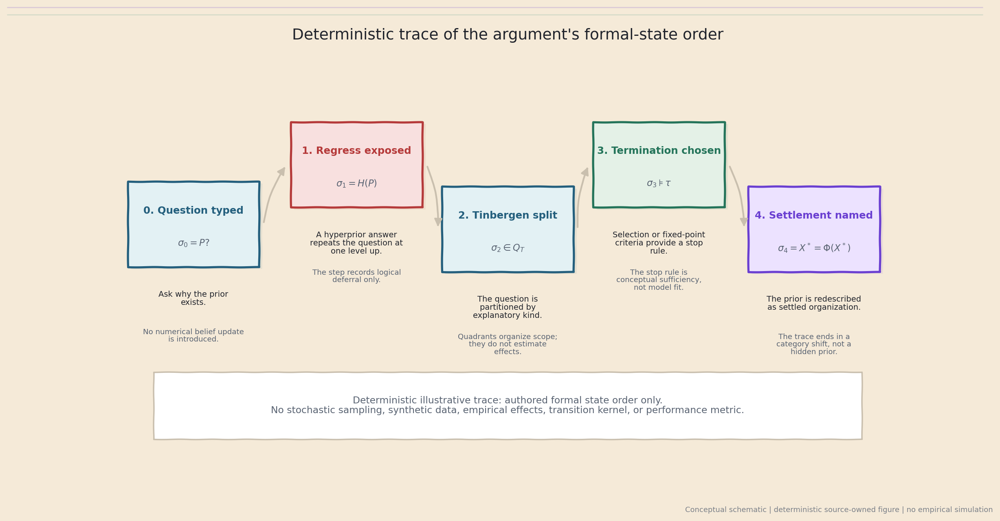{#fig:deterministic_simulation_trace}

## Scale Recurrence

[@fig:scale_recurrence_diagram] shows that the regress-termination problem
recurs at multiple scales. The fixed-point move applies at the cellular,
organismic, and social levels without requiring a new hidden prior at each
transition [@friston2013life; @kirchhoff2018markov]. The same category shift
applies recursively: the prior-like settlement at one scale becomes the
substrate for the next.

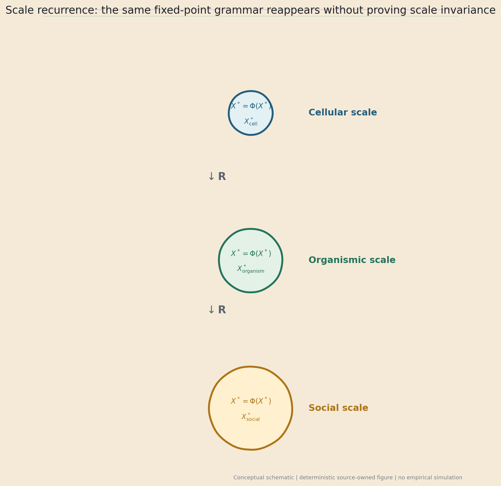{#fig:scale_recurrence_diagram}

## Source-Claim Boundary Map

[@fig:source_claim_boundary_map] makes the scholarship contract visible. The
publication pass does not treat every discovered source as equal. Discovery
scans surface candidates; primary or scholarly verification decides whether a source
is accepted, rejected, or deferred; and only accepted sources attached to claim
ledger entries reach the manuscript. This is the paper's answer to citation
inflation: sources enter only where they bound or strengthen a live claim.

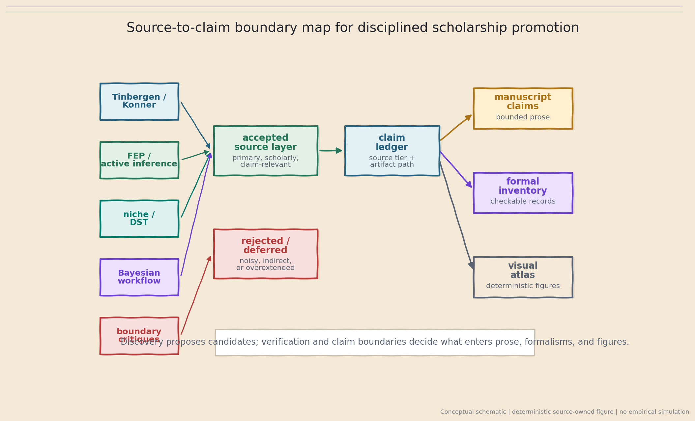{#fig:source_claim_boundary_map}

## Aesthetic Prior-Craft Map

[@fig:aesthetic_prior_craft_map] makes the title's art claim inspectable. It
does not route all aesthetic experience through prediction error. Instead, it
shows three supporting lines feeding one bounded claim: predictive aesthetics
for staged expectation, 4E and material-engagement scholarship for situated
practice, and neuroaesthetic scope controls for sensory, valuation, and meaning
systems [@frascaroli2024aesthetics; @burnett2020four_e;
@chatterjee2014neuroaesthetics; @wynn2021four_e]. The figure also keeps the claim ceiling in
view: prior-craft is not a theory of artist intention or neural updating. The
point is narrower and stronger: artworks and art-making can arrange encounters
with expectation, affordance, accident, affect, and meaning
[@dewey1934art; @noe2015strange; @malafouris2013things;
@malafouris2023enactychism].

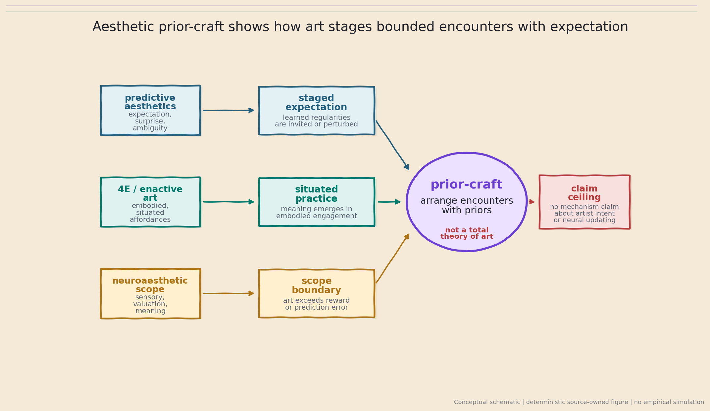{#fig:aesthetic_prior_craft_map}

## Markov Blanket Scope Split

[@fig:markov_blanket_scope_split] separates three uses of Markov blankets:
Pearl-style conditional-independence structure, Friston-style active-inference
model boundary, and realized organismal or cognitive boundary. The split lets
the argument use Markov blankets as part of fixed-point explanation while
preserving the critical distinction emphasized by the recent debate
[@bruineberg2022emperor; @raja2021markov].

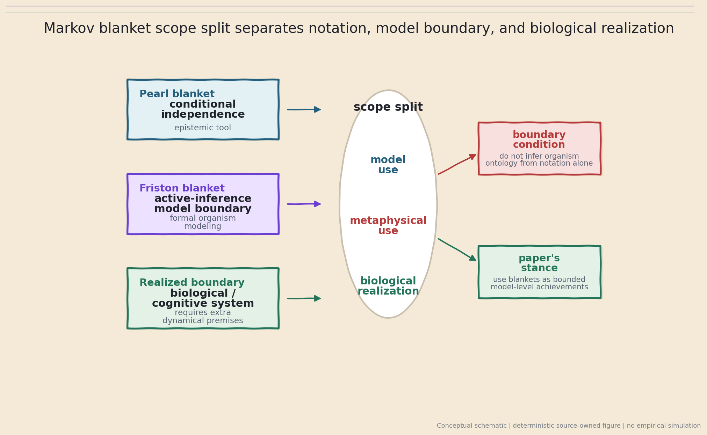{#fig:markov_blanket_scope_split}

## Niche-Prior Feedback Field

[@fig:niche_prior_feedback_field] gives the niche-construction claim a richer
shape. Organismic action, developmental resources, and cultural inheritance
operate at different timescales but feed back into the same prior-like field.
The point is not that niche construction is a fourth termination. It is a
constraint on selection termination: what persists is partly produced by the
system-niche loop that selection later filters [@constant2018free;
@stotz2017developmental; @baltieri2022extended; @laland2000niche].

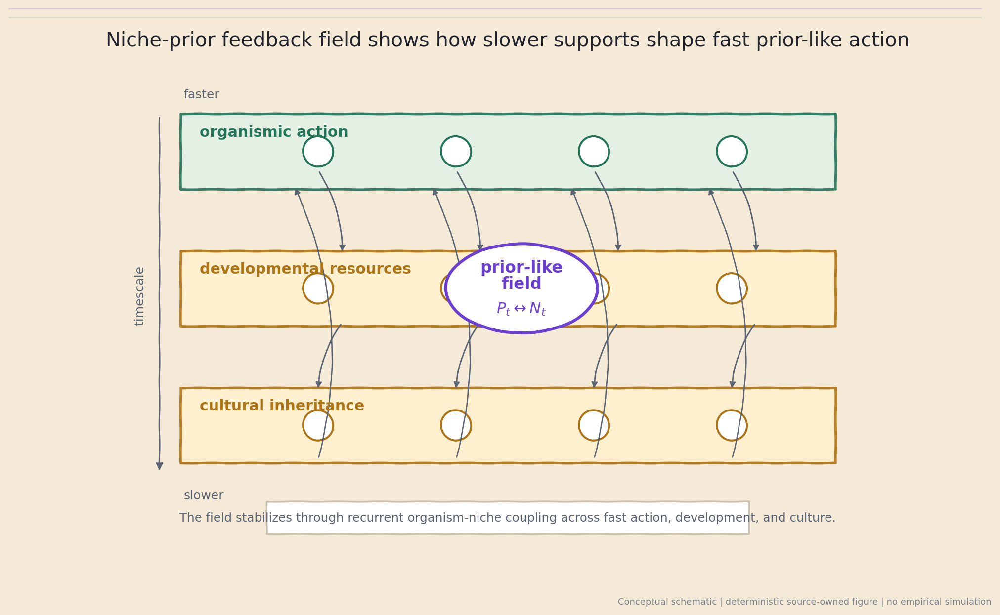{#fig:niche_prior_feedback_field}

## Before The First Prior

[@fig:first_prior_grounding_stack] answers the upstream version of the regress
question. It does not draw a prior behind the first prior. Instead, it places
viability asymmetry, allostatic regulation, co-embodiment and co-homeostasis,
developmental tuning, and cultural niche craft in a constraint stack. This
lets the figure say what "bias before bias" can mean without violating the
paper's scope: some forms are regulatable and reachable before they are
available as explicit priors [@ciaunica2021first_prior;
@allen2018body_first_prior; @sterling2012allostasis].

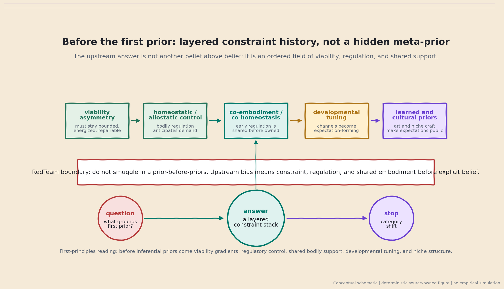{#fig:first_prior_grounding_stack}

## Figure Manifest

The visual atlas contains 18 argument diagrams. The
formal supplement adds 3 contract diagrams,
for 21 source-owned visualizations in total.

- `tinbergen_axes.png`: Four colored panels hold Tinbergen's questions in tension rather than stacking them into a causal ladder. Read across scale and then down temporality: mechanism and function can close local questions about present organization and current use, while ontogeny and phylogeny ask how that form was shaped and retained. The key visual warning is that the regress appears when one panel, usually ontogeny, is asked to speak for the whole grid. The figure therefore turns a familiar taxonomy into a guardrail against explaining a prior by merely naming its developmental source.
- `regress_terminations.png`: The upper chain is deliberately too easy to extend: a prior receives a hyperprior, then that hyperprior seems to need its own warrant. The lower register names the three different ways the picture can stop without pretending the next box solves the problem. Pragmatic, selection, and fixed-point endings are visualized as explanatory disciplines, not as empirical discoveries of prior origins. The point is not that the endings are interchangeable; each buys closure at a different price: formal sufficiency, viability filtering, or a category shift from hidden cause to settled organization.
- `prior_equilibrium_map.png`: The circular composition makes the fixed-point move visible: the prior is not another hidden object above the system, but the settled organization of the system's own process. Blanket persistence, action-perception closure, and environmental viability feed back into the same maintained form. The claim is a category shift about what is being explained, not a numerical equilibrium result. The figure should be read as a maintenance grammar: the explanatory target is the stable pattern by which the system keeps being the kind of system that can carry prior-like constraints.
- `ontogeny_hyperprior_parallel.png`: The two horizontal chains are drawn as visual echoes. A Bayesian hyperprior and an ontogenetic selector are not the same biological claim, but both can defer the question to the source that licensed the current prior. The red bracket marks that shared silhouette of deferral while preserving the difference between formal hierarchy and developmental history. The bottom warning is the important reading instruction: adding another selector, tutor, developmental episode, or higher prior can continue the chain without explaining why the chain is allowed to terminate.
- `selection_filter.png`: Candidate prior-like forms enter as a rough population, not as equal explanatory successes. The function-plus-phylogeny funnel removes forms that cannot remain available as persisting targets: fragile, miscalibrated, or overfit structures drop out of the story. Selection blocks regress by explaining availability through viability rather than placing one more selector behind the filter. The figure deliberately leaves individual fine structure outside the funnel's answer, because selection explains why a form is available to inherit, use, or refine, not every detail of how one organism acquired it.
- `policy_entanglement_bridge.png`: The large joint form on the left is intentionally prior to the separated boxes on the right. Lambda-decomposition makes policy, prior-like constraint, and state factor legible after the analytic cut, but it does not prove that those factors were ontologically first. The bridge keeps the argument focused on how cleaned-up factors are extracted from an already organized field. This matters for the paper's prior-origin question because a formal decomposition can clarify a system without becoming a story about the historical order in which the system's parts came to be.
- `formal_claim_dependency_map.png`: The map turns the formal supplement into a provenance surface. Claims F1-F12 are not decorative theorem labels; they are grounded in source records for axes, regress shape, termination moves, joint structure, niche, blanket, complementarity, and trace boundaries. Numbering follows source order, so prose, figures, and formal labels have to move together. The arrows record grounding, not theorem-level entailment. The figure's job is editorial as much as philosophical: it shows where a reader can ask which source-owned record authorizes each formal move.
- `symbol_glossary_closure.png`: The paired panels make a simple editorial demand: every formal mark used by a claim must be defined, and every definition must be used. This turns notation from ornament into an accountable surface of the manuscript. If the two sides fall out of correspondence, the package fails before render. The visual symmetry is intentionally blunt: a symbol that appears only in prose decoration, or a glossary row that never serves a claim, would make the formal supplement less trustworthy rather than more impressive.
- `text_validation_ladder.png`: The ladder treats the paper as something made, not merely written. Source records hydrate reports, figures, tokens, and render surfaces; validation then climbs the same stack after generation. A drifting caption, registry row, or prose token is therefore not a minor typo but a contract error in the artifact pipeline. The figure also explains why the project keeps manuscript prose, dashboard data, figure metadata, and validator output in the same loop instead of treating them as separate publication chores.
- `niche_construction_diagram.png`: The central prior is drawn between organism and niche because neither side owns the explanation alone. Organisms act into environments that answer back as altered regularities, affordances, and selection pressures. Viability still filters what persists, but the filter is partly made by the organism-niche loop it later appears to judge. The two-way arrows prevent the figure from becoming a simple environmental imprint model: priors are co-shaped by what organisms do, what niches make available, and what remains viable across that reciprocal history.
- `markov_blanket_achievement.png`: The boundary is deliberately drawn as a model-level partition M=(a,s) whose conditional-independence relation screens internal from external states. It is associated with settled organization, not read off the world as a literal membrane. The image keeps formal usefulness and ontological restraint in the same frame. It therefore supports the manuscript's blanket language while blocking a stronger claim that the notation alone discovers the true edge of an organism, artwork, or cognitive system.
- `explanatory_complementarity_matrix.png`: The matrix lets each Tinbergen question meet the others without being absorbed by them. Diagonal cells name each explanatory mode; off-diagonal cells mark places where coordination is legitimate but reduction is not. The regress is not caused by asking several questions. It is caused by collapsing their different jobs into one overburdened answer. The plus signs should be read as invitations to coordinate mechanism, function, ontogeny, and phylogeny, not as permission to translate all four into a single master vocabulary.
- `active_inference_cycle.png`: The loop makes active inference a practice rather than a passive estimate. Perception and inference are evaluated through variational free energy, while policy selection is evaluated through expected free energy; the objectives remain distinct inside one action-perception loop. Prior-like structure is a constraint in that coupled organization, not merely a static number placed before observation. The center of the image marks inferential pressure, while the cycle shows why that pressure only matters inside an organism-world practice of sensing, selecting, and acting.
- `variational_free_energy_landscape.png`: The basin is a picture of relative settlement inside a model, not a claim that free energy literally falls to zero. The marked path shows an approximate posterior moving toward a target posterior under a tractable bound. The figure supports a bounded settling metaphor for prior-like constraint while refusing an empirical origin story for priors. The color field is schematic geometry rather than observed data, so the reader should take it as a disciplined analogy for variational closure, not as a fitted result.
- `deterministic_simulation_trace.png`: The trace borrows the visual grammar of a state diagram while staying inside the paper's conceptual scope. Each node is an authored formal state: question, regress, Tinbergen partition, termination choice, and fixed-point settlement. The arrows record argumentative order only; the invariants block stochastic, synthetic-data, performance, or effect-size readings. The figure is included because ordered formal commitments are easier to audit visually, not because the paper runs a cognitive simulation.
- `scale_recurrence_diagram.png`: The three panels repeat the fixed-point grammar at cellular, organismic, and social registers. A prior-like settlement at one scale can become substrate for another through R, but the image does not smuggle in a new hidden prior at each transition. It shows recurrence of an explanatory problem, not mathematical scale invariance or empirical self-similarity. The repeated grammar invites comparison without erasing scale-specific mechanisms, histories, and material supports.
- `source_claim_boundary_map.png`: The map makes citation discipline part of the artwork of the paper. Discovery candidates do not flow directly into prose; they pass through verification and claim-ledger boundaries before reaching manuscript claims, formal inventory, or visual atlas. Rejected and deferred sources stay visible so scholarship does not become unbounded accumulation. The image also marks a practical rule for future edits: a source can expand the paper only when it changes a live claim, a boundary condition, or a generated artifact contract.
- `aesthetic_prior_craft_map.png`: This figure is the paper's most self-conscious art claim. Predictive aesthetics, 4E/material engagement, and neuroaesthetic scope converge on prior-craft: artworks can stage encounters with expectation, ambiguity, affordance, affect, and meaning. The red ceiling matters as much as the purple center: this is not a total theory of art, intention, culture, or neural updating. The figure's value is to keep the title term active without letting it become an empirical claim that art directly installs or rewires priors.
- `markov_blanket_scope_split.png`: The split makes three registers visible before they can be collapsed: a conditional-independence structure, an active-inference model boundary, and a realized biological or cognitive boundary. The first two support the paper's model-level argument. The third requires additional dynamical and philosophical premises, so it is held behind an explicit boundary condition. The right-hand boxes state the operational rule: use blankets to discipline model talk, not to shortcut the ontology of living or cognitive systems.
- `niche_prior_feedback_field.png`: The field layers fast organismal action, slower developmental resources, and still slower cultural inheritance. Prior-like structure stabilizes through the recurrence among these bands, including material and cultural scaffolds, rather than arriving from organism or environment alone. The field constrains selection termination without becoming a fourth stopping rule. The timescale arrow is part of the argument: what looks like an individual's prior may depend on slower supports that were already arranged by development, culture, and niche construction.
- `first_prior_grounding_stack.png`: The stack answers the RedTeam question by refusing the easy move of placing one more prior behind the first prior. Viability asymmetry, homeostatic and allostatic regulation, co-embodiment and co-homeostasis, developmental tuning, and cultural niche craft are shown as enabling constraints before explicit belief-like priors. The bottom boundary is part of the claim: upstream bias is a history of regulation and support, not an empirical discovery of a literal prior-before-priors. The stack improves the manuscript's origin story by showing how bias can be real, structured, and inherited without being another belief waiting at the beginning of the chain.


---


# Conclusion: Prior Origins as Termination Problems, Not Hidden Meta-Priors {#sec:conclusion}

The regress was never forced by Tinbergen. It appeared because an ontogenetic
answer was asked to do the work of every quadrant. Mechanism and function can
close locally. Phylogeny and function can jointly block regress through
selection. The fixed-point move goes further by denying that another prior is
needed at the same explanatory type. These three terminations are organizing
families appropriate to different explanatory kinds, not an exhaustive
catalogue. The error is to use one where another is needed, or to pretend that
a stop answers more than it does. The active inference bridge
([@sec:method]; [@sec:visual-atlas]) shows that the prior serves a
free-energy-minimizing process that couples perception and action, and the
 scale-recurrence argument shows that the same fixed-point structure recurs at
cellular, organismic, and social levels. The related work in
[@sec:scope-related] situates these claims in the broader literature, and the
artifact protocol in [@sec:artifact-protocol] documents the reproducibility
surface.

The bridge to policy entanglement is now narrow and explicit. The relevant
parallel is not merely that both topics use Bayesian language. It is that joint
organization may be prior to the factors later decomposed from it. If
lambda-decomposition treats joint structure as explanatorily primitive, then an
art of the prior can do the same for cognition: the system is not given a prior
from outside; it persists as the organization that makes prior-like constraint
legible [@da_costa2020active; @parr2022active]. In active inference terms, the
generative model is not an object carried by the agent; it is a bounded
description of the agent's mode of persisting under a Markov blanket
[@friston2013life; @kirchhoff2018markov; @bruineberg2022emperor;
@friston2023simpler]. The decomposition into policy, prior, and state is
analytically useful but ontologically secondary [@hohwy2016viability].

The niche-construction reading adds a further dimension
[@laland2000niche; @odling_smee2003niche; @constant2018free]. If the organism
partly constructs the statistical regularities it exploits, then the prior is
not fully given by the environment nor fully endogenous. It is co-shaped. This
does not change the logic of termination — it still blocks regress by naming
what persists rather than by adding another level — but it complicates the
simple inside/outside picture that the fixed-point move can suggest. The
argument therefore treats niche construction as a constraint on selection
termination rather than as a fourth stop: developmental and cultural resources
shape what can later be selected, but the logical work is still done by naming
the persisting organization rather than by adding another selector
[@bateson2004toward; @stotz2017developmental; @baltieri2022extended].

The upstream first-prior argument sharpens the same point. Asking what comes
before the first prior should not license a prior-before-priors. The better
answer is a stack of constraints that precede explicit inferential ownership:
viability, predictive regulation, co-embodiment, co-homeostasis, developmental
tuning, and niche-supported expectation. In that sense, the bias before bias is
not another belief. It is the embodied and ecological history that makes some
belief-like priors possible [@ciaunica2021first_prior;
@allen2018body_first_prior; @sterling2012allostasis;
@corcoran2025body_first_teacher; @pezzulo2022evolution].

The formal supplement adds a second constraint on the manuscript itself. If a
later revision changes the formal claims, symbols, figures, or validation checks,
the generated counts and integrity token must move with it. That is the right
level of rigor for this paper: enough structure to catch drift, without
pretending that conceptual notation has become an empirical result. The
supplement does not prove the thesis; it makes the thesis checkable against its
own artifacts.

The same discipline now governs the word "art." Predictive-processing
aesthetics makes the title more than a metaphor: artworks can organize
encounters with learned expectations, ambiguity, and meaning. Material and
enactive art scholarship strengthens the point by showing that these encounters
are often made through bodies, media, tools, affordances, and chance
[@wynn2021four_e; @march2023art; @malafouris2023enactychism]. But the paper
does not collapse aesthetic value into epistemic value, and it does not treat
the free energy principle as a general theory of art. The art here is a
practice of arranging explanatory encounters with priors while keeping the
explanatory kinds visible enough that the arrangement can be inspected.


---


# Artifact Protocol: Deterministic Generation Without Empirical Simulation {#sec:artifact-protocol}

The project deliberately preserves the template's reproducible artifact surface
while changing the research mode described in [@sec:method]. The reproducibility
claims are detailed in [@sec:reproducibility].

- Project mode: plain text, deterministic conceptual visualizations, and one deterministic illustrative simulation trace
- Simulation policy: The paper includes one deterministic illustrative simulation trace over authored formal states; it does not run stochastic simulations, synthetic-data experiments, empirical estimates, or performance benchmarks.
- Conceptual report status: available
- Formal claims generated: 12
- Symbol glossary rows generated: 35
- Text-validation checks generated: 11
- Python version: 3.12.13
- Platform: macOS-26.5.2-arm64-arm-64bit
- Generation timestamp: 2026-07-12T01:43:50Z

The retained analysis-stage script name is compatibility glue for the template
runner. It generates conceptual figures and JSON reports; it does not perform
optimization, empirical metric collection, stochastic sampling, synthetic-data
generation, or cognitive simulation. The deterministic trace artifacts record
only the authored formal-state sequence described in [@sec:visual-atlas].


---


# Reproducibility: Source-Owned Figures, Tokens, and Validation Gates {#sec:reproducibility}

The reproducibility claim is modest: the prose tokens and figures are generated
from explicit project files, and the project states its deterministic-trace
boundary. The formal supplement in [@sec:formal-supplement] provides the
integrity checks that make drift detectable before render.

- Config hash: `43a77c8fbb29bf9a`
- Version: `0.1.0`
- First author: Daniel Ari Friedman
- Keywords: priors, Tinbergen's four questions, hierarchical Bayes, free energy principle, Markov blankets, cognitive science, conceptual visualization
- Figure artifacts counted: 42
- Data artifacts counted: 4
- Report artifacts counted: 10
- Conceptual integrity token: `0694f506198f940e`
- Formal claims generated: 12
- Symbol glossary rows generated: 35
- Text-validation checks generated: 11

Regenerate the working artifacts with:

```bash
uv run python projects/working/prior_cognitive_art/scripts/optimization_analysis.py
uv run python projects/working/prior_cognitive_art/scripts/z_generate_manuscript_variables.py
```


---


# Scope and Related Work: What the Paper Uses, Bounds, and Refuses {#sec:scope-related}

The paper is not a full literature review. It uses a focused set of sources to
frame the argument introduced in [@sec:introduction] and to bound the claims
that would otherwise be easy to overstate.

## Tinbergen and Ethological Explanation

Tinbergen's four questions provide the structural device for the paper
[@tinbergen1963aims]. The questions — mechanism, function, ontogeny, and
phylogeny — were originally proposed as complementary modes of explanation for
animal behavior. Bateson and Laland's appreciation and update clarifies that
the four questions are not rival hypotheses but complementary perspectives, and
that conflating them is the recurring source of explanatory confusion
[@bateson2004toward]. Bergman and Beehner's contemporary leveling proposal
adds a useful pressure test by organizing Tinbergen around causes and
consequences rather than the familiar four-box layout [@bergman2022leveling].
This paper keeps the crossed visual grammar because it makes the prior-regress
problem easier to inspect, while accepting the deeper point that explanatory
kinds can be reorganized without collapsing into one kind. The regress appears
when one quadrant, typically ontogeny, is asked to carry the explanatory load
that belongs to all four. Godfrey-Smith's philosophy of biology provides
further background on the relationship between function, selection, and
explanation in biology [@godfrey2013theoretical]. Konner's nine-level expansion
shows how Tinbergen's framework can be subdivided for human behavioral
explanation, but this paper uses it only as a reminder that finer explanation
levels do not remove the need to keep explanatory kinds distinct
[@konner2021nine].

## Hierarchical Bayes and the Hyperprior Regress

Hierarchical Bayesian reasoning provides the formal analogue of the hyperprior
regress [@jaynes2003probability; @pearl2009causality]. In hierarchical models,
a prior on parameters is itself given a prior, and the chain can be extended
indefinitely. Gelman and Shalizi argue that in practice the chain stops for
pragmatic reasons such as model adequacy, predictive performance, and
regularization, not because a deeper level of reality is reached
[@gelman2013philosophy]. Penalized-complexity priors make one version of that
pragmatic stop explicit by centering prior choice on a simpler base model and a
controlled penalty for added complexity [@simpson2017penalising]. This is the
pragmatic-termination move in the paper's framework. The paper's contribution is
to situate that pragmatic stop alongside two other termination kinds that are
not merely conventional.

## Free Energy Principle and Markov Blanket Self-Individuation

The free energy principle is the cognitive-science home for fixed-point
individuation [@friston2010free]. Friston's "Life as We Know It" extends the
principle to self-organization and pattern regulation, arguing that
self-organizing systems that maintain their boundaries can be described as
minimizing variational free energy [@friston2013life]. The Markov blanket, the
statistical boundary separating internal from external states in a model, is
central to this move. Kirchhoff and colleagues connect Markov blankets to
biological autonomy and active inference, while Parr, Da Costa, and Friston
develop the connection among Markov blankets, free energy, and biological
self-organization [@kirchhoff2018markov; @parr2020prefrontal]. Hohwy's
"self-evidencing brain" frames the brain as a system that maintains itself by
evidence-gathering under a generative model, making the prior-like structure an
achievement rather than a given [@hohwy2016self; @hohwy2016predictive].
Ramstead and colleagues connect this to Schrodinger's question about how
organisms resist entropy [@ramstead2018answering]. The boundary literature
constrains the paper's use of this material: Bruineberg and colleagues
distinguish the epistemic use of Markov blankets in models from their
metaphysical use as physical boundaries, and Raja and colleagues argue that the
Markov blanket formalism can become a scope-expanding trick when treated as a
universal boundary detector [@bruineberg2022emperor; @raja2021markov].

## Active Inference and Policy Entanglement

Active inference extends the free energy principle to action and policy
selection [@friston2012agency; @friston2015active; @da_costa2020active;
@friston2017active]. The system selects actions that minimize expected free
energy, and the policy itself can be treated as a prior over action sequences.
Friston and colleagues' agency paper is useful here because it explicitly casts
action and posterior belief as joint free-energy minimization, not sequential
modules [@friston2012agency]. The "particular physics" and "made simpler but
not too simple" formulations generalize the principle to systems that persist
under a Markov blanket while making the mathematical scope more explicit
[@friston2019free; @friston2023simpler; @friston2024active]. The Bayesian
mechanics framework formalizes this further by showing how stationary processes
underwrite the blanket's statistical structure [@da_costa2023bayesian]. This is
where the paper's bridge to policy-entanglement and lambda-decomposition work
becomes relevant: if the joint organization of policy, prior, and state is
prior to the factors later extracted from it, then decomposition is an analytic
move, not a metaphysical one [@parr2022active; @hipolito2021active]. The
factors are useful cuts; they are not proof that the factors came first.

## Ecological-Enactive and Niche-Construction Perspectives

Bruineberg, Kiverstein, and Rietveld offer an ecological-enactive critique of
the free energy principle, arguing that the "anticipating brain" is not a
scientist testing hypotheses but an organism coupled to its environment
[@bruineberg2018free]. This does not undermine the termination framework; it
enriches it. If the prior-like structure is co-shaped by organism and
environment, then the selection filter is not purely external. Foundational
niche-construction theory supplies the broader evolutionary claim: organisms
modify the selective environments that later feed back on them, and cultural
practices can be part of that loop [@laland2000niche;
@odling_smee2003niche]. Constant and colleagues formalize a variational version
of this idea: organisms actively structure the statistical regularities they
exploit, so the prior is not fully given by the environment nor fully
endogenous [@constant2018free]. Extended active inference develops the
cognitive-niche side of that claim [@baltieri2022extended]. Stotz's
developmental-niche construction account keeps the boundary sharp: selective
niche construction and developmental niche construction are not the same causal
pattern, so the paper treats co-construction as a constraint on selection
termination rather than as a new termination kind [@stotz2017developmental].
Clark's "Surfing Uncertainty" provides an accessible synthesis of the
predictive-processing literature that situates these debates
[@clark2013surfing]. Seth's work on interoceptive
inference extends the framework to selfhood and bodily awareness
[@seth2015interoceptive; @seth2021being], and Wiese provides a careful
philosophical analysis of the Markov blanket formalism and its implications for
consciousness science [@wiese2023markov]. Ramstead, Kirchhoff, and Friston
connect the Markov blanket and free energy formalisms to cultural and encultured
cognition [@ramstead2023encultured].

## First Prior, Co-Homeostasis, and Upstream Bias

The first-prior literature gives the paper a sharper answer to the question
before the question. Allen and Tsakiris argue that interoceptive predictive
processing makes the body primary for self-modeling, so the origin of priors
cannot be separated from bodily regulation [@allen2018body_first_prior].
Ciaunica, Constant, Preissl, and Fotopoulou push that frame into early life:
the "first prior" is not a private intellectual possession but a co-embodied
and co-homeostatic condition in which regulation is scaffolded by another body
and by the environment [@ciaunica2021first_prior]. That scholarship supports
the manuscript's upstream claim only when bounded carefully. It does not prove
an ultimate prior; it helps specify what kind of non-prior condition can come
before explicit priors.

Physiology and developmental work add the next layer. Sterling's allostasis
model treats regulation as predictive control rather than mere reactive
correction [@sterling2012allostasis]. Corcoran and colleagues' body-as-first-teacher
account argues that rhythmic visceral dynamics can shape early
cognition, making bodily regularity part of the developmental source of later
expectation [@corcoran2025body_first_teacher]. The biological-scale extension
comes from morphogenesis and active inference: morphogenetic pattern formation
can be framed as variational inference, and evolved brain architectures can be
understood as predictive and active-inference solutions shaped by organismic
requirements [@kuchling2020morphogenesis; @pezzulo2022evolution]. Linson and
colleagues' ecological active-inference account keeps this embodied and
environment-facing rather than skull-bound [@linson2018active_ecological].
Together these sources support "bias before bias" as a layered constraint
history: viable form, bodily regulation, shared homeostasis, developmental
channel, and niche structure before explicit learned priors.

## Predictive Aesthetics And 4E Art

The title's "art" claim is not a full theory of art. It is a bounded use of a
developing research program that connects aesthetics with predictive
processing. Van de Cruys and Wagemans propose that visual artworks can build and
violate expectations in ways that become rewarding when structure is recovered,
while Kesner extends the account toward art experience but stresses the
difficulty of linking neural prediction to subjective and cultural meaning
[@van_de_cruys2011putting; @kesner2014predictive]. The 2024 Royal Society theme
issue makes the same boundary useful for this paper: predictive processing is a
fruitful encounter with aesthetics, especially around inference, affect, and
meaning-making, but it remains a program of hypotheses rather than an exhaustive
account of art [@frascaroli2024aesthetics; @van_de_cruys2024order].

Music cognition gives the clearest example of learned priors in aesthetic
practice. Pearce's review of statistical learning and probabilistic prediction
shows how musical enculturation can be modeled through learned regularities that
shape expectation, emotion, memory, segmentation, and meter
[@pearce2018statistical]. Starr's proposal that aesthetic experience models
human learning similarly supports the idea that aesthetic judgment can involve
Bayesian prediction and exploratory learning, but it remains a theoretical
account rather than evidence that art directly rewires priors
[@starr2023aesthetic]. Neuroaesthetics adds a second boundary. The aesthetic
triad of sensory-motor, emotion-valuation, and meaning-knowledge systems keeps
the analysis from reducing art to low-level prediction error or reward
[@chatterjee2014neuroaesthetics; @pearce2016neuroaesthetics].

The strongest counterweight comes from 4E, material-engagement, and
art-theoretic critique. Rietveld and Kiverstein's affordance landscape frames
skilled engagement as a field of possibilities for action, while Burnett and
Gallagher argue that aesthetic experience spans embodied, embedded, enacted,
and extended registers rather than one single explanatory principle
[@rietveld2014rich; @burnett2020four_e]. Dewey's art-as-experience account,
Noe's account of artworks as strange tools, and Clark and Chalmers' extended
mind thesis make the same methodological pressure visible: art is not only an
inner perceptual episode but also a public practice that recruits artifacts,
habits, bodies, and environments [@dewey1934art; @noe2015strange;
@clark1998extended]. Wynn, Overmann, and Malafouris sharpen the material
point for early technical culture: 4E cognition makes tools and artifacts part
of the explanatory field rather than passive outputs of an inner mind
[@wynn2021four_e]. Material-engagement theory adds the strongest
archaeological and creative-practice version of that point. Malafouris treats
mind as partly enacted through things, March and Malafouris discuss art through
material engagement, and enactychism places chance and accident inside the
creative process rather than outside it [@malafouris2013things;
@malafouris2019mind; @march2023art; @malafouris2023enactychism].

Imagination and improvisation sharpen the limit. Jones and Wilkinson use
predictive processing to connect prediction and imagination, and Cavedon-Taylor
asks how imagination bears on predictive accounts of perception; both are useful
because they show that generative cognition is not exhausted by passive sensory
prediction [@jones2020prediction; @cavedon_taylor2022predictive]. Gallagher's
enactive critique of surprise in improvisation then marks the line the paper
must not cross: predictive language can clarify expectation, but it can also
flatten the open-ended, situated discovery that makes art more than error
correction [@gallagher2022surprise]. Brown and Dissanayake's warning that the
arts are more than aesthetics prevents the same narrowing from the
neuroaesthetic side [@brown2009arts].

Cultural and evolutionary scholarship supports the population-scale version of
the analogy while keeping it bounded. Runaway cultural niche construction shows
how socially transmitted practices can reshape selection environments, and
Morriss-Kay's review of artistic creativity places art in a long biological and
cultural trajectory [@rendell2011runaway; @morriss_kay2010evolution]. These
sources support the manuscript's final scope: "prior cognitive art" names a
craft of arranging encounters with expectations, affordances, and explanatory
kinds, not a reduction of art to predictive coding and not evidence that any
single artwork directly installs a prior.

## Autopoiesis and Self-Producing Organization

Autopoiesis supplies the language of self-producing organization
[@maturana1980autopoiesis]. The autopoietic tradition predates the free energy
principle but shares its central insight: living systems are characterized by
their self-maintaining organization, not by their material composition. The
fixed-point termination move in this paper is the formal echo of that insight:
the prior is the settled organization of the process it constrains, not another
object behind it. Bateson's "Steps to an Ecology of Mind" provides a broader
cybernetic context for thinking about circular causality and self-referential
organization [@bateson1972steps].

## Claim Boundaries After the Scholarship Pass

The scholarship pass leaves the paper with five explicit boundaries. First,
Tinbergen and later extensions are used to keep explanation kinds distinct, not
to claim a complete taxonomy of cognition [@tinbergen1963aims;
@bateson2004toward; @bergman2022leveling; @konner2021nine]. Second, Markov
blankets are used as bounded modeling devices within active-inference and
autonomy arguments, not as automatic detectors of organismal or cognitive
ontology [@kirchhoff2018markov; @bruineberg2022emperor; @raja2021markov;
@friston2023simpler]. Third, niche construction and developmental systems
scholarship supports the co-shaping claim while also preventing the paper from
collapsing developmental and selective niche construction into one causal
pattern [@laland2000niche; @odling_smee2003niche; @constant2018free;
@stotz2017developmental; @baltieri2022extended]. Fourth, first-prior,
interoceptive, allostatic, developmental, morphogenetic, and evolutionary
active-inference scholarship supports an upstream constraint stack, not the
claim that scholarship has discovered a literal first meta-prior
[@allen2018body_first_prior; @ciaunica2021first_prior;
@sterling2012allostasis; @corcoran2025body_first_teacher;
@kuchling2020morphogenesis; @pezzulo2022evolution]. Fifth, predictive,
material-engagement, and 4E aesthetics support the claim that artworks can stage
encounters with expectation, ambiguity, affordance, affect, and meaning, but not
the stronger claim that predictive processing, epistemic value, or
neuroaesthetic reward is a complete account of art [@frascaroli2024aesthetics;
@wynn2021four_e; @malafouris2013things; @burnett2020four_e; @brown2009arts].
Those boundaries are the publication version of the argument. Decomposed
factors need not be ontologically prior to the joint structure from which they
are extracted, but the paper does not infer that joint structure from
terminology alone.


---


# Formal Supplement: Minimal Notation for Regress, Closure, and Validation {#sec:formal-supplement}

The formal layer is deliberately small. It does not claim an empirical model,
and its deterministic illustrative simulation trace does not introduce
simulation results. Its purpose is to keep the argument modular enough that
each symbolic move can be checked against the plain-language thesis developed
in [@sec:method].

The source layer currently generates 12 formal claims,
35 glossary rows, 11 text-validation
checks, 14 claim dependency edges, and
12 source-grounding edges. The inventory
token for this version is `0694f506198f940e`. This section owns
3 contract diagrams from the 21-figure set;
the other 18 figures belong to the argument atlas.

## Deterministic Trace Contract

The deterministic trace is a finite ordered object, not a transition kernel.
Let $T=(\sigma_0,\ldots,\sigma_4)$, with
$\delta(\sigma_i)=\sigma_{i+1}$ only for adjacent authored states. The
operator $\delta$ records order; it does not introduce
$p(\sigma_{i+1}\mid\sigma_i)$, an observation model, a reward function, a
sample path, or a cognitive update rule.

The trace therefore has three commitments. First, it must terminate in a named
settlement state rather than adding another hidden prior. Second, each state
must carry a local invariant that blocks numerical, empirical, synthetic-data,
or performance readings. Third, the generated JSON trace must match the
source-owned sequence in `src/conceptual_model.py`; a mismatch is treated as a
publication-package validation failure, not as a harmless visualization drift.

## Numbered Formal Claims

### Formal Claim F1: Axis partition

$Q_T = \{p,u\} \times \{\mathrm{static},\mathrm{developmental}\}$ and $O = (p,\mathrm{developmental})$.

Tinbergen explanation starts as a crossed question space. Ontogeny is one cell, not a level that can inherit the burden of the whole explanation.

### Formal Claim F2: Regress shape

$H(P)$ and $D(P)$ can both be iterated; iteration alone does not supply $\tau$.

A hyperprior operator and a developmental selector differ in content, but both can recreate the same prior-of-prior regress unless a termination condition is named.

### Formal Claim F3: Selection filter

$S(P) = P^*$ only for forms that persist under viability constraints.

Function plus phylogeny blocks regress by filtering the forms that remain available as explanatory targets.

### Formal Claim F4: Fixed-point stop

$X^* = \Phi(X^*)$; in that case $P$ names the settled organization of $X^*$.

The fixed-point answer is a category shift: the system is the prior-like settlement, rather than a bearer of one more hidden prior.

### Formal Claim F5: Decomposition caution

$\Lambda \to (\pi, P, x)$ is an analytic map, not proof that $(\pi, P, x) \to \Lambda$.

Policy, prior-like constraint, and state factors can be useful decompositions of joint organization without being ontologically prior to it.

### Formal Claim F6: Niche co-construction

$(P_{t+1},E_{t+1})=N(P_t,E_t)$ where $N$ is a niche-mediated co-shaping operator.

The prior-like organization and its environment are updated together in the conceptual recurrence. This complicates selection termination without turning niche construction into a fourth stop rule.

### Formal Claim F7: Blanket achievement

$X^* = \Phi(X^*)$ and $M=(a,s)$ with $\Pr(\eta\mid\mu,a,s)=\Pr(\eta\mid a,s)$.

The blanket claim is conditional and model-level: for a selected state partition, active and sensory variables M=(a,s) screen internal states \mu from external states \eta. The fixed point supplies an organizational context, not a proof that this conditional-independence boundary is a literal biological membrane.

### Formal Claim F8: Explanatory complementarity

$Q_T=\{e_i\}_{i=1}^{4},\ e_i\not\equiv e_j\ (i\ne j),\ \operatorname{explanation}=\bigcup_i e_i$.

The four Tinbergen questions are distinct explanatory modes that can be coordinated without one subsuming another. Conflating them is the source of the regress, not the framework.

### Formal Claim F9: Active inference bridge

$A(P,\pi): q^*=\arg\min_q \mathcal{F}(q\mid\pi,P),\quad \pi^*\in\arg\min_\pi G(\pi\mid P)$.

Active inference couples perception and action while distinguishing variational free energy for inference from expected free energy for policy selection. The expression is a bridge between the two objectives, not a claim that they are one scalar process.

### Formal Claim F10: Variational closure

$\mathcal{F}(q)=D_{KL}(q\|p^*)+\mathcal{F}^* \ge \mathcal{F}^*$; q^*=p^* only when $p^*\in\mathcal{Q}$ and the minimum is attained.

The variational free-energy bound differs from its reference minimum by a KL term under the stated decomposition. If the target is outside the variational family, the optimum is a KL projection rather than the target itself. This supports a bounded, model-internal settling interpretation; it is not a literal zero-energy claim and it does not derive the historical origin of the prior.

### Formal Claim F11: Scale recurrence

$R_k(X^*_k) = X^*_{k+1}$ for scales $k \in \{\text{cell}, \text{organism}, \text{social}\}$.

The fixed-point grammar recurs across scales: a settlement at one scale can become substrate for the next. This is a conceptual recurrence relation, not a claim of scale invariance or empirical self-similarity.

### Formal Claim F12: Deterministic trace boundary

$T=(\sigma_0,\ldots,\sigma_4)$ and $\delta(\sigma_i)=\sigma_{i+1}$ for authored conceptual states only.

The deterministic illustrative simulation records the formal state path through regress pressure and termination choice. It is a checkable exposition device, not a stochastic simulation, synthetic data generator, empirical estimate, or performance metric.

## Claim Grounding Map

The formal claims are not independent. Each edge records argumentative support
or provenance, not a theorem-level entailment; in particular, a fixed-point
description does not by itself entail a biological Markov blanket.
- **axis_partition → regress_shape**: The crossed axes show which quadrant creates regress pressure.
- **regress_shape → selection_filter**: The regress shape motivates the need for a termination condition.
- **regress_shape → fixed_point_stop**: The regress shape motivates the fixed-point alternative.
- **selection_filter → niche_co_construction**: Selection filtering is complicated by niche co-construction.
- **fixed_point_stop → blanket_achievement**: The fixed-point settlement supplies an organizational context for a bounded blanket model; it does not entail a literal biological boundary.
- **axis_partition → explanatory_complementarity**: The axis partition shows the questions are complementary.
- **decomposition_caution → niche_co_construction**: Joint structure and niche co-construction both resist factor-first readings.
- **blanket_achievement → active_inference_bridge**: The achieved blanket provides the boundary within which active inference operates.
- **fixed_point_stop → variational_closure**: The fixed-point settlement is represented as a relative variational-bound minimum.
- **active_inference_bridge → scale_recurrence**: Active inference at one scale provides the substrate for the next.
- **variational_closure → scale_recurrence**: The variational closure applies recursively at each scale.
- **explanatory_complementarity → active_inference_bridge**: Complementarity of perspectives is preserved when action and perception are unified.
- **regress_shape → deterministic_trace_boundary**: The trace records the regress shape before any termination claim is accepted.
- **deterministic_trace_boundary → fixed_point_stop**: The trace boundary preserves the fixed-point stop as a conceptual category shift.

The grounding edges are a separate provenance surface: they identify which
named source record anchors each numbered claim.

- `tinbergen_axes` → **F1** (axis_partition)
- `tinbergen_axes` → **F8** (explanatory_complementarity)
- `regress_shape` → **F2** (regress_shape)
- `regress_shape` → **F12** (deterministic_trace_boundary)
- `termination_moves` → **F3** (selection_filter)
- `termination_moves` → **F4** (fixed_point_stop)
- `joint_structure` → **F5** (decomposition_caution)
- `joint_structure` → **F9** (active_inference_bridge)
- `niche_blanket` → **F6** (niche_co_construction)
- `niche_blanket` → **F7** (blanket_achievement)
- `niche_blanket` → **F10** (variational_closure)
- `cross_scale_recurrence` → **F11** (scale_recurrence)

[@fig:formal_claim_dependency_map] shows how the numbered claims are grounded
in the same conceptual records that feed the prose, figure registry, and tests.

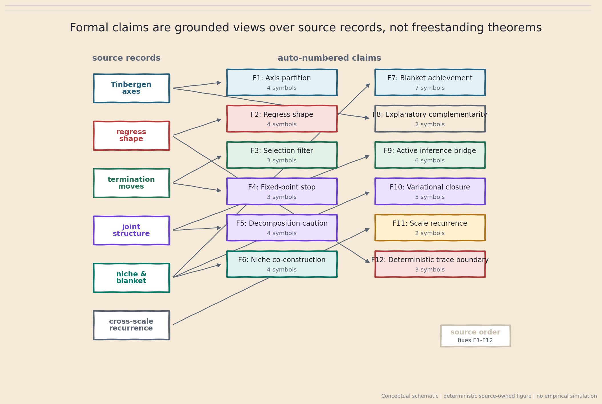{#fig:formal_claim_dependency_map}

## Symbol Glossary

All named symbols used by the formal claims appear in [@tbl:symbol_glossary].
Operators such as equality, set product, and implication are ordinary logical
notation rather than project-specific symbols.

| Symbol | Name | Role | Used in claims |
|---|---|---|---|
| $Q_T$ | Tinbergen question space | The crossed explanatory space used by the paper. | F1, F8 |
| $p$ | proximate scale | The mechanism-side explanatory scale. | F1 |
| $u$ | ultimate scale | The function or selection-side explanatory scale. | F1 |
| $O$ | ontogeny cell | The proximate-developmental quadrant. | F1 |
| $P$ | prior-like constraint | The prior or prior-like organization being explained. | F2, F3, F4, F5, F6, F9 |
| $H$ | hyperprior operator | A prior-on-prior move in hierarchical Bayes language. | F2 |
| $D$ | developmental selector | An ontogenetic prior-selection move. | F2 |
| $\tau$ | termination condition | A stop rule that prevents another regress level. | F2 |
| $S$ | selection filter | Function-plus-phylogeny filtering of viable forms. | F3 |
| $P^*$ | persisting prior form | A prior-like form that remains available for explanation. | F3 |
| $X^*$ | settled system state | A persisting self-individuating organization. | F4, F7, F11 |
| $\Phi$ | self-mapping process | The process whose fixed point is the settled system state. | F4, F7 |
| $\Lambda$ | joint organization | The entangled structure before analytic decomposition. | F5 |
| $\pi$ | policy factor | A policy factor extracted by decomposition. | F5, F9 |
| $x$ | state factor | A state factor extracted by decomposition. | F5 |
| $N$ | niche-mediated co-shaping | The operator representing organism-niche reciprocal shaping of priors. | F6 |
| $E$ | environmental state | The environmental or niche state co-shaped with prior-like organization. | F6 |
| $t$ | conceptual update index | An index for the ordered niche co-shaping recurrence. | F6 |
| $M$ | Markov blanket variables | The active and sensory variables used as a model-level conditional-independence boundary. | F7 |
| $a$ | active blanket state | An active state variable in the selected Markov blanket partition. | F7 |
| $s$ | sensory blanket state | A sensory state variable in the selected Markov blanket partition. | F7 |
| $\eta$ | external state | A state outside the selected blanket partition. | F7 |
| $\mu$ | internal state | A state inside the selected blanket partition. | F7 |
| $A$ | active inference operator | The operator coupling perception and action under a prior and policy to minimize free energy. | F9 |
| $\mathcal{F}$ | variational free energy | The upper bound on negative log evidence that the system minimizes. | F9, F10 |
| $G$ | expected free energy | The policy-level objective used for action or policy selection in the bounded bridge. | F9 |
| $\mathcal{F}^*$ | reference bound minimum | The variational free-energy value at the selected reference minimum. | F10 |
| $\mathcal{Q}$ | variational family | The family of approximate posteriors over which the variational objective is optimized. | F10 |
| $q$ | variational posterior | The approximate posterior distribution the system maintains. | F9, F10 |
| $p^*$ | target posterior | The posterior distribution approached by the variational approximation at the selected minimum. | F10 |
| $e_i$ | explanatory mode | One of the four distinct Tinbergen explanatory modes. | F8 |
| $R$ | scale recursion operator | The operator mapping a settled system at one scale to the substrate at the next. | F11 |
| $T$ | deterministic trace | The finite authored sequence of conceptual states used for illustration. | F12 |
| $\sigma_i$ | formal trace state | A named state in the deterministic illustrative trace. | F12 |
| $\delta$ | deterministic transition | The transition function that orders adjacent trace states without stochastic sampling. | F12 |

: Glossary for all named symbols used in the formal supplement. {#tbl:symbol_glossary}

[@fig:symbol_glossary_closure] visualizes the closure check. A missing symbol
row or an unused glossary row is treated as a source-contract error.

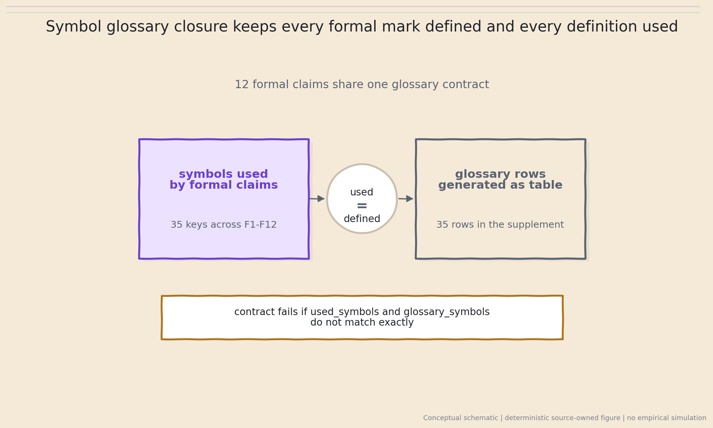{#fig:symbol_glossary_closure}

## Text-Integrity Checks

The manuscript treats prose as an artifact surface. Generated tokens do not make
the argument true, but they make several kinds of drift observable before the
paper is rendered. [@tbl:text_validation_checks] lists the checks that
guard the project contract.

| Check | Surface | Invariant | Evidence |
|---|---|---|---|
| `deterministic_simulation_boundary` | manuscript and analysis report | The project limits simulation language to a deterministic illustrative trace and rejects stochastic, empirical, synthetic-data, and performance claims. | SIMULATION_POLICY token, deterministic_simulation_manifest.json, and conceptual_analysis.json scope flags. |
| `figure_registry_closure` | figures/figure_registry.json | Every figure specification has a generated artifact and a registry label. | figure_specs() and run_analysis_pipeline() compare expected and produced filenames. |
| `symbol_glossary_closure` | formal supplement | Every symbol key used by a formal claim appears in the generated glossary. | validate_conceptual_contract() checks formal_claims() against symbol_glossary(). |
| `token_hydration` | output/manuscript | Every double-brace manuscript token is generated before render. | test_all_manuscript_tokens_are_generated and hydration script smoke test. |
| `integrity_signature` | reproducibility section | A generated token binds the conceptual inventory used by prose, figures, and tests. | CONCEPTUAL_INTEGRITY_TOKEN is derived from source records, not hand-authored prose. |
| `claim_dependency_closure` | formal supplement | Every claim dependency edge references a claim key that exists. | claim_dependencies() checks source_claim and target_claim against formal_claims(). |
| `claim_grounding_closure` | formal grounding map | Every formal claim is grounded in at least one named source record used by the grounding map. | validate_claim_grounding() checks claim_grounding() against formal_claims(). |
| `metadata_keyword_consistency` | metadata files | Keywords in config.yaml are a subset of .zenodo.json, codemeta.json, and CITATION.cff. | test_metadata_keywords_are_consistent_across_all_files checks all metadata files. |
| `citation_resolution` | manuscript references | Every citation reference in the manuscript has a bib entry in references.bib. | test_all_manuscript_citations_resolve_to_bib scans all manuscript files. |
| `figure_count_consistency` | manuscript and analysis report | The figure count in the manuscript token matches the actual number of generated figure files. | FIGURE_COUNT token and figures/*.png file count are compared by the analysis pipeline. |
| `argument_module_closure` | manuscript and source inventory | Every argument module key in the source has a corresponding discussion in the manuscript prose. | ARGUMENT_MODULES token injects the full list; the manuscript references each module by title. |

: Modular text-validation checks for the conceptual manuscript. {#tbl:text_validation_checks}

[@fig:text_validation_ladder] shows the validation posture: authored source
records hydrate the manuscript, figures, reports, and registry, and those
surfaces are checked again at render time.

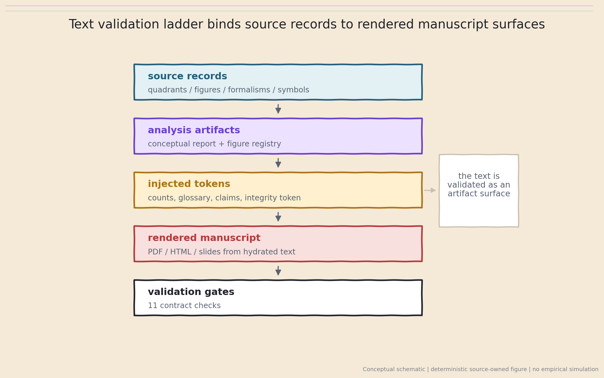{#fig:text_validation_ladder}


---


# References: Source Corpus for the Conceptual and Formal Claims

References are managed in `references.bib`.
